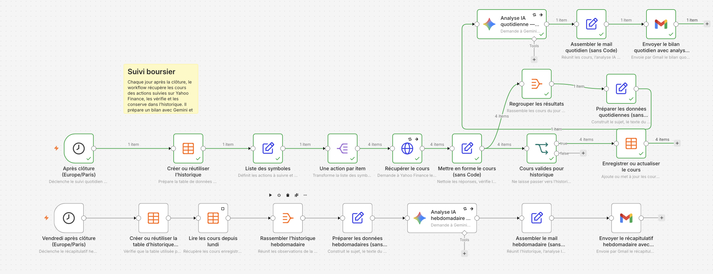

Suivi boursier n8n

Workflow n8n de suivi quotidien et hebdomadaire des cours, accompagné de deux skills Codex.

## Aperçu

Le workflow récupère les cours de Schneider Electric, Air Liquide, Dassault Systèmes et de l’ETF IUSD sur Yahoo Finance. Il conserve les observations valides dans une table n8n, prépare un bilan quotidien et un récapitulatif hebdomadaire, puis demande une synthèse à Gemini et envoie les messages par Gmail.



Le parcours quotidien est planifié du lundi au vendredi à 18 h 15 (heure de Paris). Le récapitulatif hebdomadaire est planifié le vendredi à 18 h 45.

## Fichiers

- `workflows/suivi-boursier.workflow.ts` : définition du workflow avec le SDK TypeScript n8n.
- `skills/interview/SKILL.md` : clarifier un besoin avant d’améliorer un projet.
- `skills/doubt-driven-dev/SKILL.md` : vérifier les hypothèses et les résultats pendant le travail.
- `media/workflow-preview.png` : aperçu du workflow.

## Déployer avec n8ncli

Configure d’abord l’environnement n8n dans le dépôt, puis valide et envoie le workflow :

```sh
n8ncli validate workflows/suivi-boursier.workflow.ts
n8ncli push workflows/suivi-boursier.workflow.ts
```

Après l’envoi, vérifie les accès Yahoo Finance, Gemini et Gmail dans n8n avant d’activer le workflow. Vérifie aussi le destinataire Gmail configuré dans les deux nœuds d’envoi.

## Données et confidentialité

Le fichier TypeScript contient le destinataire Gmail configuré et des références aux credentials n8n. Il ne contient pas les secrets d’authentification eux-mêmes. Vérifie ces valeurs avant de publier ou de partager le dépôt.

Une vidéo de présentation n’est pas incluse.
