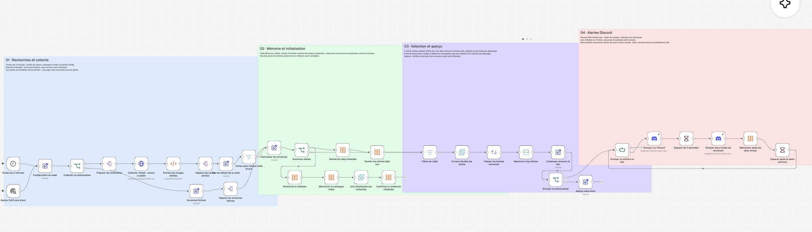

# Radar Vinted → Gemini → Discord

Projet n8n de **Mehdi Farhat** : surveiller Vinted toutes les **2 minutes**, sélectionner de nouvelles annonces et envoyer des alertes enrichies par Gemini sur le serveur **Bot Vinted new**.

**Aucun nœud Code.** Discord et Gemini utilisent leurs intégrations natives n8n. Le workflow comporte **38 nœuds de traitement et 5 sticky notes** ; des expressions n8n assurent les calculs et la mise en forme.



*Capture fournie du radar compact. La version publiée ajoute un bloc Gemini entre la sélection et les alertes.*

## Fonctionnement

1. **Collecter** : recherches selon la saison en heure de Paris, catalogue HTML public Vinted et extraction des cartes articles.
2. **Mémoriser** : première collecte d’une recherche enregistrée sans envoyer le catalogue existant ; ensuite seuls les articles inconnus sont candidats.
3. **Sélectionner** : filtres de prix, taille et état, dédoublonnage, classement et **5 articles maximum par passage**.
4. **Analyser avec Gemini** : photo jointe si disponible, informations de l’annonce et jusqu’à 12 annonces de la même recherche comme comparables. Fourchette de revente et examen visuel prudent.
5. **Alerter sur Discord** : salon de marque puis `#toutes-les-annonces`, lien **Acheter sur Vinted**, pause de 2 secondes entre envois. Mémorisation après les deux envois réussis.

## Gemini natif

- Modèle : **`gemini-flash-lite-latest`**.
- **Google Search désactivé** : le nœud texte définit `googleSearch: false` ; l’opération native d’analyse d’image n’utilise aucun outil de recherche. URL Context et Code Execution sont aussi désactivés pour le texte.
- Avec photo HTTPS : **Analyze image**. Sans photo : **Message a model**.
- Prompt en **HTML**, avec règles et **trois exemples fictifs** : estimation sur comparables, informations insuffisantes, indices visuels suspects. Source : [`gemini-radar.html`](gemini-radar.html).
- Le HTML est un **prompt envoyé au modèle**, pas une page qui expose une clé API. La photo est transmise à Gemini pour l’analyse.
- Si Gemini échoue ou renvoie une réponse inexploitable, l’alerte reste disponible avec la mention **IA indisponible**.

La fourchette indique une **estimation avant frais**, à partir de prix demandés ou de connaissances générales. Le workflow ne consulte pas les ventes conclues et n’ouvre pas automatiquement la page détaillée de chaque article. Il ne garantit ni prix de revente ni bénéfice. Sans éléments suffisants, Gemini peut refuser de chiffrer.

L’analyse d’authenticité distingue **indéterminée**, **indices suspects** et **aucun indice évident**. Une photo ne permet pas de certifier un article authentique ; le message demande les vues manquantes : étiquettes, logo, coutures ou code produit.

## Exemple vérifié

Test d’aperçu exécuté dans n8n sur cinq articles, **sans message Discord ni écriture en mémoire**. Un article provenait d’une collecte publique réelle : *Pull Nike trail*, prix demandé **40 €**, taille M, neuf avec étiquette, avec photo.

Gemini a proposé **25–40 € avant frais**, confiance faible, et une authenticité **indéterminée**, en demandant des gros plans des étiquettes et des coutures. Les quatre articles de test sans photo ni comparables ont reçu une réponse prudente sans estimation chiffrée. Les réponses peuvent varier entre exécutions.

## Sélection

| Critère | Réglage |
| --- | --- |
| Prix demandé | 2 à 50 € |
| Tailles adultes | S, M, L, XL |
| État déclaré | Bon état, très bon état, neuf avec ou sans étiquette |
| Exclusions du titre | Enfant, bébé, junior, kids, lot, replica, réplique, faux |
| Classement | Priorité de saison, marge si référence renseignée, puis prix |

Profils Nike, Ralph Lauren, Lacoste, Adidas, Carhartt, Patagonia, Columbia, Levi’s et Uniqlo selon la saison. Le classement précède Gemini et ne valide pas l’authenticité. Frais et livraison sont des hypothèses configurables.

## Fichiers

- [`radar_vinted.workflow.ts`](radar_vinted.workflow.ts) : définition TypeScript avec le SDK officiel `@n8n/workflow-sdk`.
- [`radar-vinted.json`](radar-vinted.json) : export prêt à importer dans n8n.
- [`gemini-radar.html`](gemini-radar.html) : prompt HTML, règles et exemples.
- [`radar-vinted.png`](radar-vinted.png) : capture fournie du workflow.
- [`export-workflow.mjs`](export-workflow.mjs) : génération du JSON depuis TypeScript.

## Installation

1. Importer `radar-vinted.json` dans un workflow vide.
2. Créer la table **`Memoire_Radar_Vinted`**, colonnes texte **`cle`** et **`profil`** ; sélectionner cette table dans les nœuds de mémoire si nécessaire.
3. Choisir un identifiant **Discord Bot API** dans les deux nœuds Discord. Le bot doit accéder aux salons et pouvoir envoyer des messages et des liens intégrés.
4. Choisir un identifiant **Google Gemini (PaLM) API** dans les deux nœuds Gemini. Vérifier l’accès au modèle et les quotas du compte.
5. Adapter serveur et salons dans Discord et **Composer annonce et lien**, puis prix, recherches et frais dans **Configuration du radar**.
6. Tester **Aperçu fictif sans envoi** : il appelle Gemini mais ne publie rien sur Discord. Vérifier ensuite collecte et permissions avant de publier.

L’export public est **inactif** et contient des emplacements d’identifiants à remplacer, **aucun token**. Les clés restent dans les identifiants n8n.

Avec Node.js 22.18 ou plus récent :

```sh
npm install
npm run check
npm run export
```

Le dernier appel produit `dist/workflow.json`. TypeScript décrit les nœuds et connexions ; il n’ajoute aucun nœud Code.

## Vérification et limites

- Comparaison des filtres et du classement sur les **12 mois** avec la version précédente.
- Vérification de l’extraction des cartes, du routage et des liens.
- Test n8n réussi des deux branches Gemini et des cinq messages préparés, sans envoi Discord.
- Compilation TypeScript et comparaison des paramètres et connexions après reconstruction par le SDK.

La collecte conserve **un nœud HTTP Request pour Vinted**, faute d’intégration native adaptée. L’accès public et le HTML peuvent changer ; une page vide ou des cartes incomplètes ne produisent pas d’alerte. Une erreur de collecte n’équivaut pas à une absence de nouvelles annonces.

Gemini peut atteindre un quota ou produire une réponse inexacte. Si le premier envoi Discord réussit et le second échoue, une relance peut répéter le premier message. La mémoire réduit les doublons entre passages, sans garantir une livraison exactement une fois.
