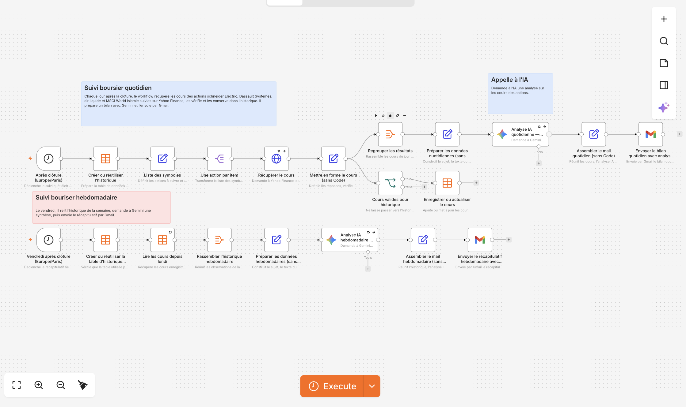

# Suivi boursier avec n8n

Ce dépôt contient un workflow n8n qui suit quatre valeurs, conserve les cours dans une table n8n et envoie des bilans par Gmail. Gemini rédige une courte synthèse à partir des données calculées par le workflow.

Valeurs suivies : Schneider Electric (`SU.PA`), Air Liquide (`AI.PA`), Dassault Systèmes (`DSY.PA`) et l’ETF MSCI World Islamic (`IUSD.DE`). Les cours proviennent de Yahoo Finance.

## Fonctionnement

- **Du lundi au vendredi à 18 h 15 (heure de Paris)** : le workflow récupère les cours, conserve les données valides dans la table `Historique_Bourse_v1`, prépare le bilan quotidien et l’envoie par Gmail.
- **Le vendredi à 18 h 45** : il compare le premier et le dernier cours enregistré depuis le lundi, demande une synthèse hebdomadaire à Gemini, puis envoie le récapitulatif par Gmail.

Le bilan hebdomadaire dépend de l’historique enregistré par les exécutions quotidiennes. S’il y a moins de deux cours dans la semaine pour une valeur, le courriel indique que l’historique est insuffisant.



## Fichiers

- `workflows/suivi-boursier.workflow.ts` : définition TypeScript du workflow.
- `media/workflow-preview.png` : aperçu du workflow.
- `skills/interview/SKILL.md` : clarifier un besoin avant d’améliorer un projet.
- `skills/doubt-driven-dev/SKILL.md` : vérifier les hypothèses et les résultats.

## Configuration et déploiement

Configure d’abord ton environnement n8n avec `n8ncli env edit <nom>`. Vérifie dans n8n que les identifiants Gemini et Gmail utilisés par le workflow sont disponibles, puis valide et envoie le fichier :

```sh
n8ncli validate workflows/suivi-boursier.workflow.ts
n8ncli push workflows/suivi-boursier.workflow.ts
```

Avant d’activer le workflow, vérifie le destinataire configuré dans les deux nœuds Gmail et lance une exécution manuelle pour confirmer que les données sont enregistrées et que les courriels arrivent correctement.

## Confidentialité

Le workflow contient l’adresse destinataire Gmail en clair. Le dépôt étant public, cette adresse est visible. Remplace-la dans les deux nœuds Gmail si tu ne souhaites pas la rendre publique. Les secrets d’authentification restent dans les identifiants n8n.

